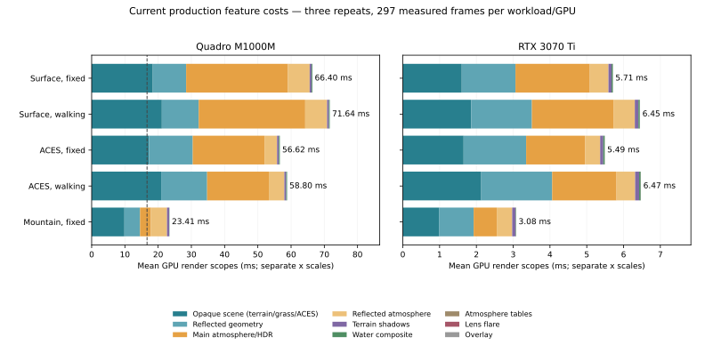

# Current renderer feature costs — 2026-10-09

After restarting with the other renderer instance closed, the RTX 3070 Ti renders
the measured warm views in roughly 3–6 ms. The Quadro M1000M takes 23–75 ms:
atmosphere/HDR, opaque geometry and reflections dominate its steady cost.
Terrain preparation is a separate latency problem. Walking captures encounter
roughly 3.6-second synchronous refreshes; CPU shoreline and surface-error
refinement account for most of the topology work. This study measures the
current NASA ACES renderer and changes no rendering algorithms or TODO rows.

## Inputs and method

- Base source/binary: `82dedb2`, RelWithDebInfo (`-O2`), using the installed
  NASA ACES asset. Exact binary, asset, adapter and configuration hashes are in
  [summary.json](summary.json). [inputs.json](inputs.json) preserves the measured
  production configuration, including the user's uncommitted grass edits:
  **40.72 blades/m², 0.13 m width and 15 m quad distance**. The older 60 FPS study
  uses different inputs and remains a historical result.
- Compute terrain and `gpu-v1` grass planning; Earth land cap 100,000 triangles,
  relief sinking and 0.05 m geometric-error target. Adaptive foliage allocation
  stays active. No density reduction or common locked GPU budget was imposed.
- NVIDIA 580.178.04, verified physical UUIDs on every completed run:
  Quadro M1000M, 2 GiB, `GPU-2cefee61-6b3b-a670-c390-c7449dad3f79`;
  RTX 3070 Ti, 8 GiB, `GPU-1795f01b-f1fd-61a0-3b79-199560dd0793`.
  Both reported **0% utilization before the restarted study**. Temperatures
  were 51/47°C and occupied memory 226/50 MiB, respectively. Periodic telemetry
  remains local. The earlier contended pilot is excluded entirely.
- Sequential NVIDIA EGL/OpenGL 4.3 captures at 1280×720, RGBA8/depth24/stencil8,
  four-sample pbuffer, using `gpu_compare/EglCapture.cpp`. GPU order alternates
  between three repeats. There is no desktop presentation or monitor limit;
  final `glFinish`/image readback is outside the frame timer.
- Five workloads, two GPUs, three repeats: **30 primary runs**. Each has 120
  frames; frames 0–19 and the final image-readback frame are excluded, leaving
  **297 measured frames per workload/GPU, 2,970 total**. Complete GPU samples,
  zero dropped stage events and zero cached-scene renders were checked. Binary,
  configuration and asset hashes remained unchanged throughout.
- `surface-*` uses first-person camera 2 at production startup:
  latitude −17.2307275444°, longitude 79.3919745759°, 2 m ground clearance,
  simulation time 0. `aces-*` uses camera 4 and the astronaut at that start.
  `mountain-idle` uses the reported mountain view at −18.7260251555°,
  113.2376248869°, 2 m clearance and time 180.346673067, including the user's
  saved NED direction/up. Mountain settings are derived from the frozen input.
- Orbit/wind advance by 1/60 s per frame. Walking advances 0.1 m/frame, or
  6 m/s of benchmark time. This overrides the saved free-camera walk speed;
  it does not measure wall-time interactive travel. No sprint or flying route
  is included. Capture mode waits for complete terrain publication.
- Percentiles use nearest rank on pooled retained frames. Preparation spikes
  are retained. CPU-traced diagnostics are separate runs and never substituted
  for the primary timings. CPU wall/thread time and nested GPU timers overlap;
  they must not be added to one another.

## Frame times, including preparation spikes

Milliseconds; 297 frames in every row. “Prep” counts frames with terrain or
grass preparation, including allocation-only changes without a terrain upload.

| Workload | GPU | Median | p95 | p99 | Maximum | Prep frames |
|:--|:--|--:|--:|--:|--:|--:|
| surface-idle | Quadro M1000M | 67.06 | 72.26 | 167.97 | 171.89 | 11 |
| surface-idle | RTX 3070 Ti | 5.84 | 6.64 | 12.32 | 12.58 | 0 |
| surface-walk | Quadro M1000M | 73.78 | 160.37 | 3666.45 | 3693.80 | 15 |
| surface-walk | RTX 3070 Ti | 6.15 | 8.44 | 3653.00 | 3684.86 | 3 |
| aces-idle | Quadro M1000M | 57.34 | 60.31 | 161.39 | 163.36 | 9 |
| aces-idle | RTX 3070 Ti | 5.71 | 6.67 | 12.12 | 12.69 | 0 |
| aces-walk | Quadro M1000M | 60.05 | 148.79 | 3645.03 | 3695.12 | 15 |
| aces-walk | RTX 3070 Ti | 6.05 | 10.68 | 3657.73 | 3693.93 | 3 |
| mountain-idle | Quadro M1000M | 23.38 | 23.99 | 24.20 | 24.95 | 0 |
| mountain-idle | RTX 3070 Ti | 3.33 | 3.92 | 4.36 | 4.52 | 0 |

Each walking group has three terrain-upload frames, one per repeat. The Quadro
has twelve additional grass-only preparation frames per walking group; its
stationary startup groups have eleven/nine grass-only preparations. Startup
scene frames are separate: median first-frame time is approximately 3.7–3.95 s
at production startup and 2.38–2.49 s at the mountain. Driver/shader caches were
not cleared between processes, so these are first-scene measurements rather
than a controlled cold-cache benchmark.

Warm RTX p95 values fit the 16.67 ms budget, but walking p99 does not. All measured
Quadro views exceed the budget even without refreshes. These are offscreen
results; a synchronous capture refresh is not evidence of an equally long
native UI freeze. Native workers can keep presenting the previous generation,
although the preparation latency still delays new terrain/grass availability.

## GPU render features

Means in milliseconds over all 297 retained frames. These are enclosing render
stages, not a decomposition into every mesh or shader.

| Feature | Surface idle, Quadro | Surface idle, RTX | ACES walk, Quadro | ACES walk, RTX |
|:--|--:|--:|--:|--:|
| Opaque scene: terrain/grass/ACES | 18.392 | 1.602 | 20.913 | 2.132 |
| Reflected geometry | 10.036 | 1.460 | 13.828 | 1.928 |
| Main atmosphere/HDR | 30.644 | 2.021 | 18.572 | 1.750 |
| Reflected atmosphere | 6.523 | 0.507 | 4.671 | 0.506 |
| Terrain shadows | 0.546 | 0.084 | 0.553 | 0.109 |
| Water composite | 0.257 | 0.034 | 0.259 | 0.042 |
| Atmosphere tables, warm reuse | 0.001 | 0.003 | 0.001 | 0.003 |
| Lens flare, inactive | 0.000 | 0.000 | 0.000 | 0.000 |
| Overlay, disabled scope | 0.001 | 0.003 | 0.001 | 0.003 |



The panels use **different horizontal scales**. The dashed 16.67 ms line is
visible in the Quadro panel; it lies beyond the RTX axis. Bars show enclosing
GPU render scopes, excluding preparation outside those scopes. They are not
wall-frame times or a hardware speedup comparison.

At the Quadro startup view, main atmosphere/HDR accounts for about 46% of the
66.40 ms GPU total, opaque rendering 28%, and reflected geometry plus atmosphere
25%. The atmosphere scope also includes HDR/compositing and metering work.
Warm table reuse is cheap here; this does not measure table-generation cost.
Water's final composite and shadows are comparatively small.

Terrain, grass rasterization and the ACES mesh share opaque/reflection timers.
**The ACES mesh has no independent GPU timer in these measurements.** Comparing
camera 2 with camera 4 cannot isolate astronaut cost: the viewpoint, grass draw
count and atmosphere workload change. Jetpack bubbles are inactive on these
grounded routes. Lens flare contributes zero in the measured views and the
overlay is disabled; these values do not estimate their enabled costs.

Adaptive allocation also changes work between cards. Endpoint main-view grass
instance counts below include detailed blades and quads. Ranges cover three
run endpoints, not every frame. Every reported Earth policy retains the
configured 40.72/m² protected density and reports `near_infeasible=false`.

| Workload | Quadro endpoint instances | RTX endpoint instances |
|:--|--:|--:|
| surface-idle | 70,419 | 160,661 |
| surface-walk | 68,557–87,398 | 158,107 |
| aces-idle | 93,395 | 168,553 |
| aces-walk | 72,031–90,815 | 160,569 |
| mountain-idle | 5,314 | 5,314 |

## Grass and terrain compute events

Per-event GPU means/p95 in milliseconds for `surface-walk`. Events can be
nested inside render scopes or run during preparation. **Do not add these
numbers to the render-feature table.** Other workloads are in the JSON summary.

| Event | Quadro events | Quadro mean / p95 | RTX events | RTX mean / p95 |
|:--|--:|--:|--:|--:|
| Grass placement, main | 297 | 2.143 / 2.532 | 297 | 0.466 / 0.597 |
| Grass placement, reflection | 297 | 2.111 / 2.475 | 297 | 0.490 / 0.595 |
| Grass metadata | 15 | 2.449 / 2.580 | 3 | 2.493 / 2.701 |
| Grass allocation | 15 | 84.286 / 87.178 | 3 | 127.305 / 137.669 |
| Terrain field | 6 | 18.755 / 37.361 | 6 | 17.920 / 40.586 |
| Terrain expansion | 6 | 0.965 / 1.253 | 6 | 0.600 / 0.878 |

The six terrain field events are **Earth land and water batches for three
refreshes**, not six whole-planet builds or Moon work. For example, one RTX
ACES-walk refresh spends 33.26 ms on land fields and 1.07 ms on water fields.
Bulk field evaluation is much smaller than the CPU topology build below.

Allocation is a burst cost: ACES-walk averages 85.24 ms/event on Quadro and
119.62 ms on RTX. Quadro surface-idle also reallocates eleven times, averaging
85.61 ms GPU/event despite no terrain rebuild; RTX has no measured allocations
in that stationary group. The allocation implementation performs budget/density
search and sorting across many dispatches. Different adaptive budgets and event
patterns mean these timings do not isolate hardware allocator speed. They do
identify allocation reuse and dispatch work as useful spike investigations.

## CPU preparation and render-thread work

Separate CPU traces record Linux thread CPU as well as inclusive wall time.
The dominant initial Earth worker scopes are:

| View | Worker scope | Quadro wall / thread CPU ms | RTX wall / thread CPU ms |
|:--|:--|--:|--:|
| Startup | Total topology build | 3258.91 / 3257.11 | 3236.94 / 3225.54 |
| Startup | Shoreline refinement | 1465.43 / 1464.78 | 1458.78 / 1455.00 |
| Startup | Surface-error refinement | 1408.23 / 1407.30 | 1382.35 / 1375.50 |
| Mountain | Total topology build | 1964.67 / 1963.68 | 1967.93 / 1967.09 |
| Mountain | Surface-error refinement | 1637.28 / 1636.52 | 1639.83 / 1639.25 |

Refinement rows are children of topology, so adding them to its total would
double-count. Their wall/thread agreement identifies CPU computation on the
Earth worker. The separate Moon worker topology takes roughly 6.1 ms. At startup,
shoreline and error refinement together consume about 2.85 s of a 3.25 s build.
Moving more bulk noise sampling to GPU alone cannot remove this cost.

Render-thread inclusive averages per retained frame, including walking refreshes:

| Diagnostic | GPU | Whole frame wall / thread CPU ms | Mesh preparation wall / thread CPU ms | Grass draws wall / thread CPU ms |
|:--|:--|--:|--:|--:|
| surface-idle | Quadro | 77.052 / 76.244 | 3.959 / 3.907 | 28.114 / 28.063 |
| surface-idle | RTX | 7.008 / 6.912 | 0.090 / 0.083 | 2.237 / 2.233 |
| aces-walk | Quadro | 100.317 / 65.123 | 40.715 / 5.918 | 26.416 / 26.360 |
| aces-walk | RTX | 45.288 / 10.778 | 37.281 / 2.864 | 2.848 / 2.849 |
| mountain-idle | Quadro | 24.636 / 24.438 | 0.149 / 0.106 | 14.435 / 14.431 |
| mountain-idle | RTX | 4.511 / 4.442 | 0.087 / 0.083 | 1.425 / 1.427 |

“Grass draws” includes main/reflection calls. Calling-thread CPU can include
NVIDIA driver activity, busy waits and capture diagnostic readbacks; it is not
an isolated C++ grass calculation. These scopes also overlap their ancestors.
Tracing overhead is visible, particularly on RTX, so use the uninstrumented
primary table for frame budgets.

The first Quadro stationary diagnostic retained 26 frames. An initial short
ACES diagnostic failed the visible-astronaut endpoint check because the route
ended with an occluded character. It supplies no accepted timing sample. The
remaining five diagnostics were resumed with the successful primary 120-frame
route, retaining 99 frames each. Both runner revisions are hashed in the summary;
all 30 primary runs and six accepted CPU diagnostics completed successfully.

## Priorities supported by this run

1. For steady Quadro rendering, investigate atmosphere/HDR and reflected rendering,
   then opaque foliage/terrain cost, using image comparisons to bound quality
   changes. Water blending and shadow cost offer much smaller savings here.
2. For terrain readiness, investigate incremental/reused shoreline and surface-error
   topology work while keeping bounded background publication. CPU planning is
   the dominant generation cost even with compute field evaluation enabled.
3. For preparation spikes, examine adaptive grass allocation frequency and its
   search/sort dispatch batches while retaining protected near-camera density.
   The measurements do not prove every reallocation is unnecessary.

These are conclusions from the requested analysis, not additional TODO tasks.
No optimization or new sustained native-60-FPS claim is included in this update.

## Evidence and reproduction

Committed evidence is limited to this study, the compact [summary](summary.json),
the input snapshot and the vector plot. Raw frame/work/CPU traces, rendered
images, telemetry, logs, adapter and Python plotting environment remain ignored
under `build-f5/feature-costs/restarted/`. The summary hashes the complete local
`results.json`; missing raw files do not imply successful archive validation.

With a matching native build, NVIDIA/EGL/GLEW development libraries and both
GPUs available, run from the repository root:

```sh
python3 -B scripts/benchmarks/feature_costs/run.py \
  --binary build/PlanetSimulation \
  --config docs/journal/benchmarks/feature-costs/inputs.json \
  --output-dir build-feature-costs/current
```

`--devices` selects physical EGL device indices; the recorded UUID/card must be
checked for the intended device. `--resume` continues completed runs only when
the binary, input, asset and measurement method still match. Fresh runs use 120
frames for all CPU diagnostics. Reporting requires Matplotlib (this plot used
3.9.4); publish a new local report without overwriting this historical study:

```sh
python3 -B scripts/benchmarks/feature_costs/report.py \
  build-feature-costs/current/results.json \
  --journal-dir build-feature-costs/current/report
```

The reporter writes pooled statistics, the input snapshot, SVG, local Markdown
tables and a local PNG preview. Verification for this update includes source
compilation of both Python helpers, existing CPU-report tests, layout/whitespace
checks, frame/sample counts, input/asset hashes and a visual plot check.
